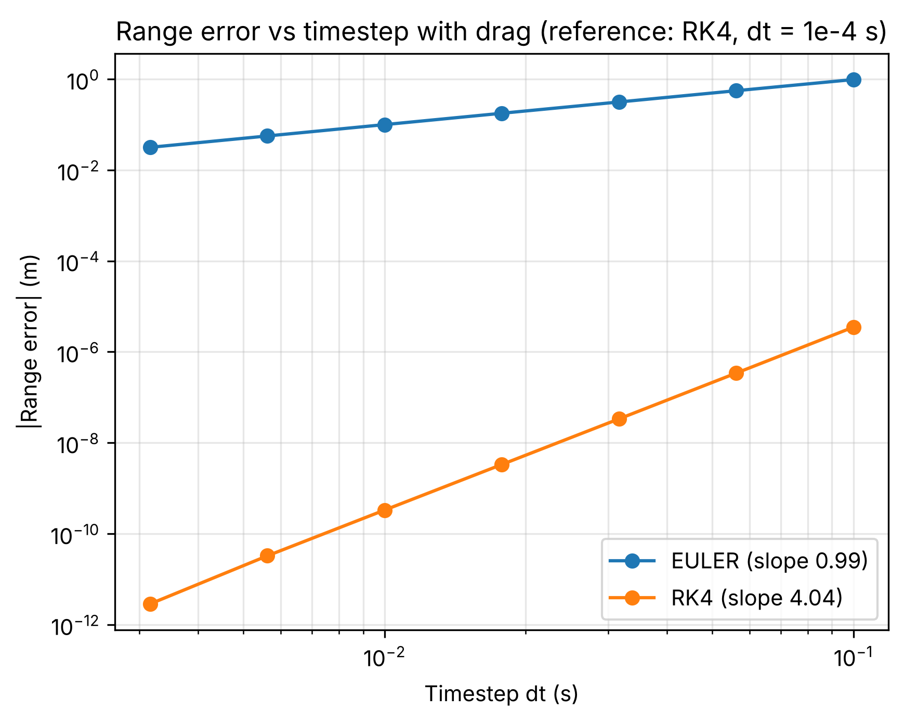
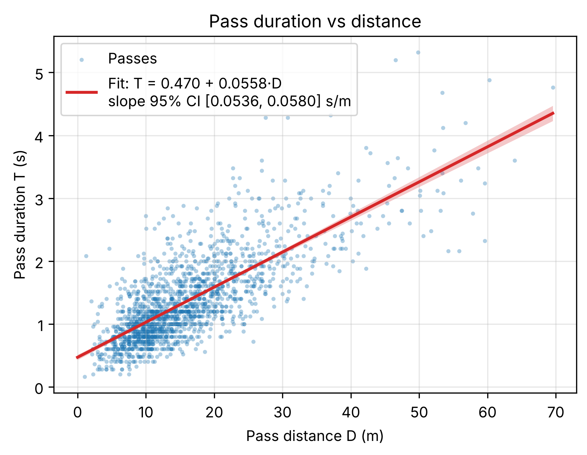
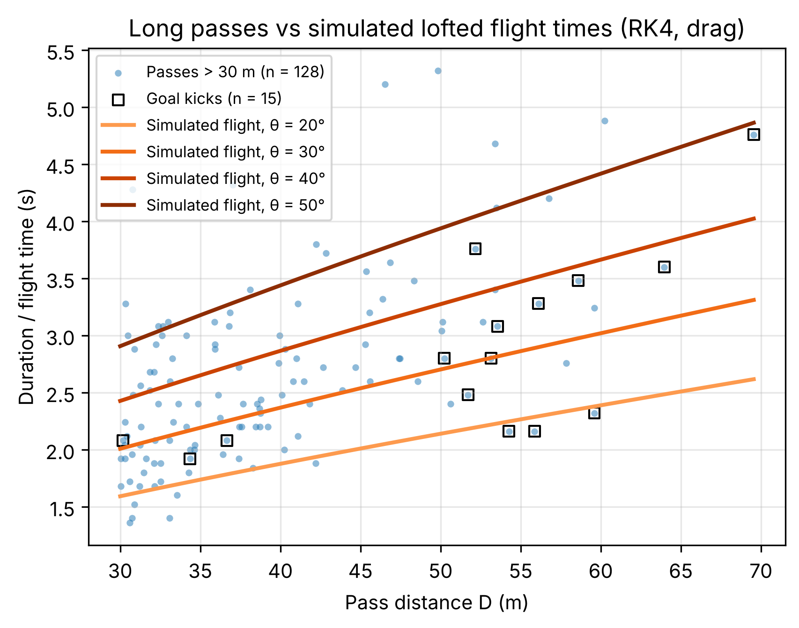
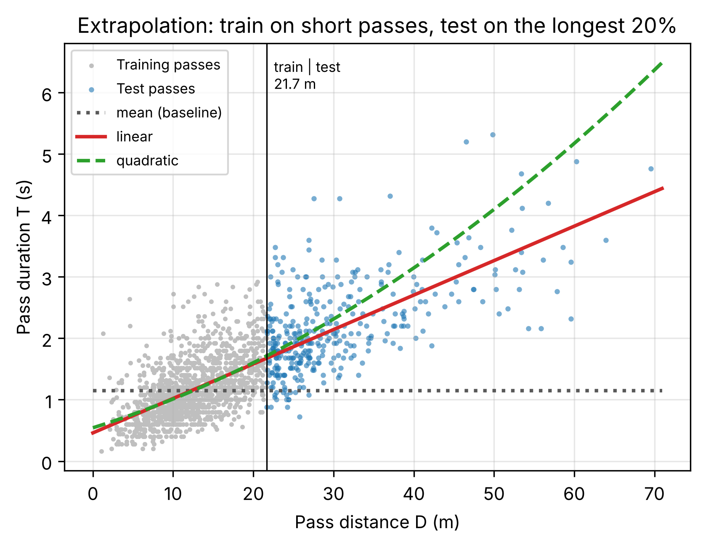

# Football physics: how does a kicked ball fly, and how fast are real passes?

**PH1050 Foundation of Computational Physics, IIT Madras · Final Group Project, Problem 10**

This project builds a 2D physics model of a kicked football (gravity, quadratic air drag and a bouncing ground), integrates it with Euler and RK4, and verifies it. It then tests the model against real match data: 1,752 passes and about 170,000 ball-tracking frames from two professional matches. Finally, it builds a simple data-driven model that predicts how long a pass takes from how far it goes.

**Main findings**

- The simulator is verified:
  - RK4 reproduces the exact no-drag range and flight time to about 1e-13.
  - Energy is conserved without drag, and only decreases with drag. The energy lost equals the work done by drag to within 2 parts in 10 million.
  - The measured orders of accuracy are 1.00 for Euler and 4.04 for RK4.
- In real matches, a pass takes **0.47 s + 0.056 s per metre**. The slope's 95% confidence interval is 0.053–0.059 s/m, so each extra metre is covered at about 18 m/s.
- Long passes (over 30 m) match simulated lofted balls launched at **about 36°** (95% CI 34–39°).
- A straight line fitted only on short passes predicts the longest 20% of passes almost without bias. A quadratic over-predicts them. **The linear model is the better choice.**

---

## Contents

1. [Quick start](#quick-start)
2. [Repository structure](#repository-structure)
3. [Data](#data)
4. [Part 1: physics model (simulate and verify)](#part-1-physics-model-simulate-and-verify)
5. [Part 2: data and statistics](#part-2-data-and-statistics)
6. [B5: simulated lofted passes vs real long passes](#b5-simulated-lofted-passes-vs-real-long-passes)
7. [Part 3: data-driven model](#part-3-data-driven-model)
8. [Conclusions and inferences](#conclusions-and-inferences)
9. [Limitations](#limitations)
10. [Tests](#tests)
11. [Where each rubric line is addressed](#where-each-rubric-line-is-addressed)
12. [Who did what](#who-did-what)

---

## Quick start

```bash
# 1. install dependencies (Python 3.9 or newer)
pip install -r requirements.txt

# 2. download the raw match data (only needed to re-run Part 2's cleaning and ball speeds)
git clone --depth 1 https://github.com/metrica-sports/sample-data.git data/sample-data

# 3. run each part, in this order (every script works from any folder)
python Part_1/COMPHY_part1_verification.py   # -> Results/Part_1/
python Part_2/part2_statistics.py            # -> Results/Part_2/  and  data/passes_clean.csv
python Part_2/part2_lofted_comparison.py     # -> Results/Part_2/b5_*   (about 20 s)
python Part_3/part3_model.py                 # -> Results/Part_3/

# 4. run the tests (35 tests, about 5 s, no raw data needed)
python -m pytest -q
```

The cleaned pass table `data/passes_clean.csv` is committed to the repository, so the B5 comparison and Part 3 can be run without downloading the raw data. Only `part2_statistics.py` needs `data/sample-data/`.

Every script saves its printed results to a `*_summary.txt` file in its `Results/` folder, so numbers can be copied into the report without re-running anything.

---

## Repository structure

```
.
├── Part_1/                              Physics model and its verification
│   ├── COMPHY_FOOTBALL_SIMULATOR.py         the simulator (Euler, RK4, drag, bounces, launch-speed solver)
│   ├── COMPHY_part1_verification.py         analytic check, energy checks, convergence study, bounces
│   └── test_part1.py                        tests for the simulator
├── Part_2/                              Real data: cleaning, statistics, comparison with the model
│   ├── part2_statistics.py                  pass cleaning, ball speeds, duration-vs-distance fit
│   ├── part2_lofted_comparison.py           B5: simulated lofted flight times vs long passes
│   ├── test_part2.py                        tests for cleaning, speeds and the fit
│   └── test_b5.py                           tests for the B5 comparison
├── Part_3/                              Data-driven model
│   ├── part3_model.py                       baseline / linear / quadratic, random and extrapolation tests
│   └── test_part3.py                        tests for the models, splits and scores
├── Results/                             Everything the scripts produce (figures, tables, summaries)
│   ├── Part_1/
│   ├── Part_2/                              part2_* = statistics, b5_* = lofted-pass comparison
│   └── Part_3/
├── data/
│   ├── passes_clean.csv                     1,752 cleaned passes (written by part2_statistics.py)
│   └── sample-data/                         raw Metrica data (downloaded, not committed: 234 MB)
├── README.md
├── requirements.txt
└── .gitignore
```

How the pieces connect:

```
Part_1/COMPHY_FOOTBALL_SIMULATOR.py ──────────────────────────────┐
        │                                                         │
        ▼                                                         ▼
Part_1/COMPHY_part1_verification.py           Part_2/part2_lofted_comparison.py (B5)
                                                                  ▲
data/sample-data/ ─► Part_2/part2_statistics.py ─► data/passes_clean.csv
                                                                  │
                                                                  ▼
                                                     Part_3/part3_model.py
```

---

## Data

**Source:** [Metrica Sports sample data](https://github.com/metrica-sports/sample-data), Sample Games 1 and 2, used with acknowledgement as the data's README requests. These are two anonymised professional matches, and the event data and tracking data are synchronised.

| What | File | Used for |
|---|---|---|
| Event data | `Sample_Game_N_RawEventsData.csv` | every pass, with start and end time and start and end position |
| Tracking data | `Sample_Game_N_RawTrackingData_Home_Team.csv` | ball position at 25 Hz (the last two columns) |

- **Pitch coordinates:** positions are given as fractions of the pitch (0 to 1 on each axis). The pitch is 105 × 68 m, so x is multiplied by 105 and y by 68 to get metres.
- **Why real data:** the assignment allowed real or generated data. Real data is a genuine test of the model. It contains effects the simulator leaves out (spin, rolling after landing, passes received in the air), which is what the assignment asks for.
- **No ball height:** the tracking is a bird's-eye view of the pitch (x, y on the grass). Pass distance on the pitch plays the role of the simulated range, and pass duration plays the role of flight time.
- **Only completed passes:** we use events of type `PASS`. Failed passes (`BALL LOST`) end at an interception rather than at the intended receiver, so their durations are not comparable.

---

## Part 1: physics model (simulate and verify)

### The model (`Part_1/COMPHY_FOOTBALL_SIMULATOR.py`)

A ball of mass M = 0.43 kg and radius R = 0.11 m moves in the vertical plane, with state (x, y, vx, vy):

$$\frac{d\mathbf v}{dt} = -g\,\hat{\mathbf y} - \frac{K}{M}\,|\mathbf v|\,\mathbf v, \qquad K = \tfrac12 \rho C_d \pi R^2, \quad C_d = 0.25,\ \rho = 1.2\ \text{kg/m}^3$$

- **Integrators:** forward Euler (first order) and classical RK4 (fourth order).
- **Landing:** when a step would go below the ground, the exact landing time inside that step is found by bisection, using the same integrator for the partial step. This keeps each method's order of accuracy intact.
- **Bounce:** the vertical velocity is reversed and multiplied by e = 0.7 (vy → −0.7·vy).
- **`launch_speed_for_range(D, θ)`:** finds, by Brent's method, the launch speed that lands the ball D metres away at angle θ. B5 uses it.

### Verification (`Part_1/COMPHY_part1_verification.py`)

**Known no-drag case** (time step dt = 0.01 s; table in `no_drag_comparison_table.tex`):

| Case | Method | Range error | Flight-time error |
|---|---|---|---|
| 25 m/s, 35° | Euler | 0.20 m (0.34%) | 0.010 s |
| 25 m/s, 35° | RK4 | 2.4e-13 m | 2.2e-14 s |
| 20 m/s, 45° | Euler | 0.14 m (0.35%) | 0.010 s |
| 20 m/s, 45° | RK4 | 1.2e-13 m | 2.1e-14 s |
| 30 m/s, 20° | Euler | 0.28 m (0.48%) | 0.010 s |
| 30 m/s, 20° | RK4 | 1.6e-13 m | 4.4e-16 s |

RK4 is exact up to rounding error. With constant gravity the trajectory is a polynomial in time, and RK4 integrates polynomials of this degree exactly.

**Energy** (launch at 25 m/s and 35°, E₀ = 134.375 J):

- **No drag, RK4:** the largest relative drift is 1.1e-15, so energy is conserved to rounding error.
- **No drag, Euler:** energy grows to +0.606 J (a relative drift of 4.5e-3). This is predictable exactly. Each Euler step adds ½Mg²dt², so E − E₀ = ½Mg²·dt·t. The prediction matches the simulation to 1.7e-13 J at every step before the final partial step. The drift is a property of Euler's method, not a bug.
- **With drag:** energy only decreases, for both methods, over one flight and over 4 bounces. It falls to 57.5 J by the first landing.
- **Energy budget:** the energy lost equals the work done by drag, ∫K|v|³dt. They agree to 1.4e-5 J out of 76.9 J lost. This is a quantitative check, not just "energy goes down".

**Convergence** (error in range against dt, for dt from 0.1 s to 0.003 s, on a log-log plot; the order is the slope of a straight-line fit):

| | Euler | RK4 |
|---|---|---|
| No drag (vs the exact formula) | **1.00** | at rounding error (≤ 7e-13 m), so no slope |
| With drag (vs RK4 at dt = 1e-4 s) | **0.99** | **4.04** |

**Bounces:** with no drag, successive flight times are 2.923, 2.046, 1.432 and 1.003 s. Each is exactly 0.7 times the last, as the bounce rule requires.

### Figures (`Results/Part_1/`)

| Figure | What it shows | How to read it |
|---|---|---|
| `nodrag_energy_conservation.png` | Relative energy drift on a log scale | RK4 stays near 1e-15. Euler grows, and lies exactly on the dotted ½Mg²·dt·t prediction. |
| `drag_energy_decrease.png` | Total energy with drag | It falls fastest just after the kick, because drag power ∝ v³. |
| `drag_bounce_energy.png` | Energy through 4 bounces | Smooth losses to drag, plus a sudden step at each bounce, where a bounce keeps only e² = 49% of the vertical kinetic energy. |
| `drag_energy_budget.png` | Energy lost against drag work, and their difference | The two curves overlap. The difference is at most 1.4e-5 J. |
| `nodrag_convergence_study.png` | Range error against dt, no drag | Euler has slope 1. RK4 is flat at rounding error. |
| `drag_convergence_study.png` | Range error against dt, with drag | Euler has slope 0.99 and RK4 4.04. Halving dt cuts RK4's error 16×. |
| `trajectories.png` | Paths with and without drag, 3 bounces | Drag makes arcs shorter, lower and lopsided, with a steeper descent. Without drag, each bounce peak is e² of the last. |



---

## Part 2: data and statistics

### Cleaning the passes (`Part_2/part2_statistics.py`)

The rules are applied in order, and each pass is counted under the first rule it fails:

| Step | Dropped | Left |
|---|---|---|
| Raw `PASS` events (games 1 and 2) | — | 1,763 |
| Missing coordinates or times | 0 | 1,763 |
| Zero or negative duration | 2 | 1,761 |
| Zero distance | 0 | 1,761 |
| Implied average speed above 40 m/s (a timing error, e.g. 10.8 m in 0.08 s) | 9 | **1,752** |

43 passes start or end up to 3 m outside the pitch lines. They were **kept**, because that is realistic near a touchline.

For each pass, distance = √((Δx·105)² + (Δy·68)²) and duration = end time − start time. The median pass is **13.7 m** (range 1.1–69.6 m) and lasts **1.20 s** (range 0.16–5.32 s).

### Ball speeds from tracking

- **Method:** speed = distance moved between frames ÷ time between frames (0.04 s at 25 Hz). A pair of frames is used only if **both have a ball position, they are exactly one frame apart and they are in the same half**. Otherwise a gap in the tracking would show up as one huge jump.
- **Missing positions:** about 40% of frames have no ball position, mostly while the ball is out of play.
- **Glitches:** speeds above 40 m/s are removed. **347 were removed** (0.20%), 183 in game 1 and 164 in game 2, leaving 170,853 speeds.
- **Median speed: 5.53 m/s.** It is low because most of the time the ball is being dribbled or rolling, not in mid-pass.
- **99th-percentile speed: 22.53 m/s.** This is typical of hard passes, long balls and shots.

### Pass duration against distance (C4)

A least-squares straight-line fit to all 1,752 passes gives:

$$T = 0.470\ \text{s} + 0.0558\ \text{s/m} \times D \qquad (R^2 = 0.58)$$

| | Slope (s/m) | 95% confidence interval |
|---|---|---|
| Standard formula (from the slope's standard error) | 0.0558 ± 0.0011 | [0.0536, 0.0580] |
| Bootstrap (2,000 resamples of the passes) | — | [0.0529, 0.0589] |

**How to read it:**

- **The slope.** Each extra metre adds 0.056 s, so the extra distance is covered at 1/0.0558 ≈ **18 m/s** (17–19 m/s).
- **The intercept.** Even a very short pass takes about **0.47 s**, roughly the time to play the ball and for the receiver to control it.
- **The two numbers together.** A typical pass's distance divided by its duration is closer to 12 m/s, because of that fixed half second. So 18 m/s is the speed at which *extra distance* is covered, not the average pass speed.
- **Which interval to quote.** The bootstrap interval is slightly wider because the scatter grows with distance. It does not assume equal scatter everywhere, so it is the one to quote.
- **R².** Distance explains 58% of the variation in duration. The rest comes from how hard the ball is struck, its path, and how it is received.

### Figures (`Results/Part_2/`)

| Figure | What it shows | How to read it |
|---|---|---|
| `part2_pass_histograms.png` | Distributions of distance and duration | Both are lopsided to the right: mostly short passes, with a thin tail of long balls. Only about 7% are over 30 m. |
| `part2_ball_speeds.png` | Frame-to-frame ball speeds (log y-axis) | Dashed line: median. Dotted line: 99th percentile. The small spikes at 35–40 m/s are probably leftover glitches just under the cutoff. |
| `part2_duration_vs_distance.png` | Each pass, the fitted line and its 95% band | The band is the uncertainty in the *line*, not the spread of individual passes, so most points are expected to lie outside it. |



---

## B5: simulated lofted passes vs real long passes

**Method (`Part_2/part2_lofted_comparison.py`):**

1. For each launch angle θ from 10° to 60° (in 2.5° steps), simulate the ball (RK4 with drag) over a range of launch speeds. Record where it lands and how long it was in the air.
2. Look up, for each real pass longer than 30 m, the simulated flight time of the lofted ball that lands at that distance.
3. Compare the observed duration with the simulated flight time. The error on the difference is its standard error and a 95% bootstrap interval.
4. Find the **effective launch angle**: the angle at which the simulated and observed times agree on average. Its interval comes from bootstrapping the passes.

Goal kicks are compared separately, because they are almost always lofted.

**Plausibility check:** the launch speed the model needs to reach each distance.

| Angle | 30 m | 45 m | 60 m |
|---|---|---|---|
| 20° | 24.8 m/s, 1.59 s | 32.9 m/s, 2.01 s | 41.4 m/s, 2.39 s |
| 30° | 21.5 m/s, 2.01 s | 28.6 m/s, 2.54 s | 36.2 m/s, 3.02 s |
| 40° | 20.3 m/s, 2.43 s | 27.3 m/s, 3.07 s | 34.9 m/s, 3.66 s |
| 50° | 20.7 m/s, 2.91 s | 28.2 m/s, 3.69 s | 36.6 m/s, 4.42 s |

**Results:** mean of (observed − simulated) flight time, ± standard error.

| Group | n | θ = 20° | θ = 30° | θ = 40° | θ = 50° | **Effective angle [95% CI]** |
|---|---|---|---|---|---|---|
| All passes > 30 m | 128 | +0.80 ± 0.06 s | +0.31 ± 0.06 s | −0.18 ± 0.06 s | −0.76 ± 0.06 s | **36.4° [34.2°, 38.6°]** |
| Goal kicks > 30 m | 15 | +0.67 ± 0.17 s | +0.09 ± 0.16 s | −0.49 ± 0.15 s | −1.17 ± 0.15 s | **31.6° [26.6°, 36.9°]** |

**How to read it:**

- **The model matches on average at a realistic angle.** The angle that makes it agree with the data, about 32–36°, is typical of a lofted pass.
- **Individual passes scatter a lot.** Even at the best angle the RMSE (typical error for a single pass) is about 0.7 s, because every pass is kicked at its own angle.
- **The missing physics is visible.** Reaching 60 m needs about 35 m/s in the model, which is at the top end of real kicks. Real long balls carry further than our drag-only model allows, consistent with **backspin lift (the Magnus effect), which the model does not contain**.

| Figure | What it shows | How to read it |
|---|---|---|
| `b5_lofted_vs_passes.png` | Long passes (dots), goal kicks (squares) and simulated flight-time curves at 20°, 30°, 40° and 50° | A steeper angle means a longer flight. Most data lie between the 30° and 40° curves. Points below 20° are driven passes or balls received in the air; points above 50° bounced or rolled before being received. |
| `b5_residual_vs_angle.png` | Mean (observed − simulated) against assumed angle, with a 95% band | Where a line crosses zero is the effective angle. The goal-kick band is wider because it is based on only 15 kicks. |



---

## Part 3: data-driven model

**Models (`Part_3/part3_model.py`):** predict the mean duration (baseline), a straight line, and a quadratic, all fitted by least squares. Scores are on held-out test passes:

- **RMSE:** the typical prediction error. Lower is better.
- **MAE:** the average size of the error, ignoring sign.
- **Bias:** the average of predicted minus observed. Positive means predictions are too long.

The 95% intervals come from 2,000 bootstrap resamples of the test passes. Model-against-model differences use a **paired** bootstrap: the same resampled passes for both models.

### Test 1: random 80/20 split (1,402 train, 350 test, seed 0)

| Model | Test RMSE (s) [95% CI] | MAE (s) | Bias (s) |
|---|---|---|---|
| Mean (baseline) | 0.663 [0.599, 0.728] | 0.514 | +0.004 |
| Linear | **0.415** [0.373, 0.456] | 0.318 | +0.025 |
| Quadratic | **0.415** [0.373, 0.457] | 0.317 | +0.025 |

- **Linear against baseline:** linear's RMSE is lower by 0.250 s [0.188, 0.312]. That cuts the error by about 40%.
- **Quadratic against linear:** quadratic's RMSE is lower by just 0.0001 s, with an interval of −0.003 to +0.003 s. They are **indistinguishable**.
- **Repeated over 200 random splits:** the average RMSE is 0.679 ± 0.041 s for the baseline, 0.440 ± 0.024 s for linear and 0.441 ± 0.024 s for quadratic.

### Test 2: extrapolation, short to long (D6)

Train on the 1,402 shortest passes (up to 21.7 m), and test on the 350 longest (21.7–69.6 m).

| Model | Test RMSE (s) [95% CI] | MAE (s) | Bias (s) |
|---|---|---|---|
| Mean (baseline) | 1.290 [1.194, 1.384] | 1.062 | −1.049 |
| Linear | **0.599** [0.541, 0.658] | 0.457 | **−0.027** |
| Quadratic | 0.719 [0.653, 0.790] | 0.552 | +0.206 |

- **Quadratic against linear:** quadratic's RMSE is **higher by 0.119 s [0.069, 0.174]**. The interval does not include zero, so the linear model is genuinely better.
- **Fitted lines:** trained on short passes only, linear gives T = 0.459 + 0.0561·D. On all passes in Part 2 it gave 0.470 + 0.0558·D, so the two are almost identical.

**Conclusion (D6):**

- **Inside the data's range**, linear and quadratic are equally good, and both beat the baseline easily.
- **Beyond the training range**, the quadratic bends upward and predicts long passes as about 0.2 s too slow. The straight line extrapolates with almost no bias (−0.03 s).
- **What this means:** pass duration is well described by a fixed delay plus a constant time per metre, all the way from 2 m to 70 m.
- **Why linear's error is still higher on long passes** (0.60 s, against 0.42 s on the random split): long passes vary more in duration. The model is not biased.

| Figure | What it shows | How to read it |
|---|---|---|
| `part3_random_split.png` | Training passes (grey), test passes (blue) and the three models | The linear and quadratic curves almost overlap. The flat baseline misses both short and long passes. |
| `part3_extrapolation.png` | The same, trained only on passes left of the 21.7 m line | The quadratic curves upward past the cut. The line runs through the middle of the long passes. |
| `part3_rmse_comparison.png` | Test RMSE with 95% bootstrap error bars, for both tests | Lower is better. Use the paired differences above, not overlapping error bars, to decide whether two models differ. |

Tables: `part3_results.tex` (ready for the report) and `part3_results.csv`.



---

## Conclusions and inferences

1. **The simulator is trustworthy.**
   - It reproduces the exact no-drag solution.
   - It conserves energy when it should, and accounts for every joule drag removes.
   - Its accuracy improves at the theoretical rates: order 1 for Euler, 4 for RK4.
   - RK4 at dt = 0.01 s is accurate to better than 1e-9 m with drag, far below any effect we study. Euler at the same step is off by about 10 cm and gains energy.
2. **Real passes take a fixed ~0.47 s plus ~0.056 s per metre** (95% CI 0.053–0.059 s/m). Extra distance is covered at about 18 m/s.
3. **Ball speeds:** the median frame-to-frame speed is 5.5 m/s, because the ball spends most of its time near players' feet. The 99th percentile is 22.5 m/s.
4. **Long passes behave like ~36° lofted kicks on average**, but individual passes scatter by about 0.7 s. The launch speeds the model needs for 60 m passes are at the top end of real kicks. This points to backspin lift, which the model leaves out.
5. **For prediction, a straight line is the right model.** It ties with a quadratic on held-out passes and beats it clearly when extrapolating to long passes. The quadratic's extra flexibility only fits noise in the short passes.

## Limitations

- **The model leaves out real effects:** spin (Magnus lift and curl), rolling after landing, wind, and the ball deforming at the bounce. Drag uses a single constant C_d = 0.25, although for a real ball C_d changes with speed.
- **The tracking data has no height.** We cannot tell a lofted pass from a driven one, except for goal kicks.
- **Pass duration runs from kick to the next touch.** That can be before landing (a header) or after a bounce, so it is not exactly a flight time.
- **Timing resolution:** event times have 0.04 s resolution (one frame), which limits accuracy for very short passes.
- **Limited data:** only two matches. Only 128 passes are over 30 m, and only 15 are goal kicks over 30 m.
- **Possible leftover glitches:** the 40 m/s glitch cutoff is the assignment's rule. Some spikes just below it are probably still glitches.

---

## Tests

`python -m pytest -q` runs 35 tests in about 5 s. The Part 2, B5 and Part 3 tests use small made-up inputs, so they do not need the raw data.

| File | What it checks |
|---|---|
| `Part_1/test_part1.py` | RK4 matches the exact no-drag formulas (3 cases); Euler is within 1%; RK4 conserves energy; Euler's drift equals ½Mg²·dt·t; energy only decreases with drag (with and without bounces); energy lost equals drag work; measured orders are about 1 and 4; bounce flight times scale by e; a launch at θ = 0 lands immediately; the launch-speed solver matches the no-drag formula and lands on target |
| `Part_2/test_part2.py` | Pitch fractions convert to metres correctly; cleaning drops each kind of bad pass, and counts each one once; speeds skip missing frames, gaps in frame numbers and half-time; the glitch filter removes the right speeds; the line fit recovers a known slope, and its intervals contain it |
| `Part_2/test_b5.py` | The flight-time lookup agrees with direct root-finding; the comparison measures a known offset correctly; the effective angle is recovered from simulated 30° data; asking for a distance outside the lookup raises an error |
| `Part_3/test_part3.py` | The baseline predicts the training mean; the line fit recovers known coefficients; the scores are right on a hand-worked example; the random split uses every pass exactly once; the extrapolation split tests on exactly the longest 20%; on data that are truly a straight line, the linear model is unbiased and beats the baseline |

---

## Where each rubric line is addressed

| Rubric | What is asked | Where |
|---|---|---|
| B2 | No-drag range and flight time reproduced | `Results/Part_1/no_drag_comparison_table.tex`, `part1_summary.txt` |
| B3 | Energy conserved without drag, decreasing with drag | `nodrag_energy_conservation.png`, `drag_energy_decrease.png`, `drag_bounce_energy.png`, `drag_energy_budget.png` |
| B4 | Log-log error plot with measured orders | `nodrag_convergence_study.png`, `drag_convergence_study.png` |
| B5 | Simulated lofted-ball flight times vs long passes, with an error | `Results/Part_2/b5_*.png`, `b5_summary.txt` |
| C4 | Confidence interval for the slope (s/m), read correctly | `part2_duration_vs_distance.png`, `part2_summary.txt`, and the section above |
| D6 | Short/long pass test, with a conclusion | `Results/Part_3/part3_extrapolation.png`, `part3_rmse_comparison.png`, `part3_results.tex` |

---

## Who did what

| Member | Roll number | Contributions |
|---|---|---|
| _Name_ | _Roll no._ | _e.g. simulator and Part 1 verification_ |
| _Name_ | _Roll no._ | _e.g. data loading, cleaning and ball speeds (Part 2)_ |
| _Name_ | _Roll no._ | _e.g. B5 comparison and Part 3 model_ |
| _Name_ | _Roll no._ | _e.g. report, slides and tests_ |

---

*Data: Metrica Sports sample data (https://github.com/metrica-sports/sample-data), used with acknowledgement.*
